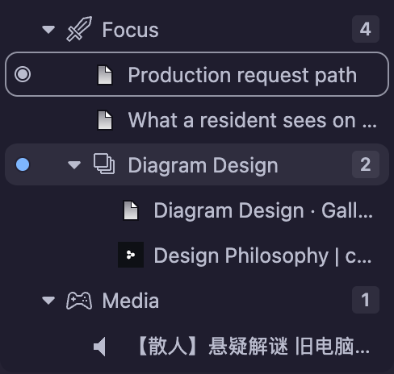

# Vivaldi Manager

A browser extension that communicates with the Vivaldi browser to show tabs, workspaces, and reading list.

Requires a JS mod to be installed in Vivaldi that responds to messages from the extension.

Tabs belonging to no workspace are shown in a "Default" workspace.

## Interface

- The popup contains 2 tabs:
    1. Tabs: Shows all open tabs in the current window, organized by workspace.
    2. Reading list: Shows all items in the reading list.
- Operations mainly through keyboard shortcuts, but mouse actions are also supported: close button shows on hover; drag and drop is supported for moving tabs.
- `ctrl-n` to switch between the two tabs.

## Tabs

- Focus on the current tab when popup is opened.
- The tabs are organized by workspace. A workspace has its own row, but this row can't be focused on.
- Within each workspace, tabs are sorted by their order in the tab bar.
- A stack has its own row, which can be focused on. All tabs in the stack are shown below with indentation.
- Elements on a tab row:
    - Favicon
    - Title
    - Audio icon
- Actions on a tab row:
    - Activate tab
    - Select tab(s)
    - Close tab
    - Move tab(s)
        - Moving a tab between two stacked tabs adds the tab to the stack.
        - Moving a tab across workspaces moves the tab to the other workspace.
    - Stack tabs / Remove tab from stack
    - Add tab(s) to reading list
    - Copy tab URL
- Elements on a workspace row:
    - Workspace icon
    - Workspace name
    - Tab count
- Elements on a stack row:
    - A colored dot indicating the stack color
    - Stack name
    - Tab count
- Actions on a stack row:
    - Edit stack name
    - Change stack color
    - Unstack tabs
    - Close all tabs in the stack
    - Add all tabs in the stack to reading list
- Support fuzzy matching to search for tabs (title or url) or stacks (name).
- Different modes:
    1. Normal mode: `j/k` move the focus between rows. `tab` selects rows. `v` enters the move mode. `/` enters the search mode.
    2. Move mode: the current row is marked with a background color. `j/k` move it up/down. If the current row is a stack, the whole stack is moved.
    3. Search mode: show a search input. Arrow keys move the focus.
- Keyboard shortcuts:
    - `j/k`: Move focus up/down, wrap around the list.
    - `J/K`: Move focus while bypassing tabs in stack. In move mode, move the current tab over a stack instead of moving into it.
    - `tab`: Select current row and move to next row. Selecting a stack selects all tabs in the stack. Can't select rows from a second workspace.
    - `v`: Enter/exit move mode
    - `/`: Enter search mode
    - `esc`: Exit move/search mode
    - `x`: Close current/selected item(s)
    - `enter`: Activate current tab, or (when in search mode and focusing on a stack) exit search mode and focus on the stack
    - `y`: Copy current/selected item(s) URL
    - `g`: create a stack with selected tabs
    - `G`: dissolve a stack or remove selected tabs from a stack
    - `i`: Edit a stack's name. Shows a text input with the current name. Press `enter` to save, or `esc` to cancel.
    - `s`: Add current/selected tab(s) to reading list
    - `S`: Add all tabs to reading list

## Reading List

- Elements on a row:
    - Favicon
    - Title
    - Domain
    - Read state
- Actions on a row:
    - Open item
    - Mark as read/unread
    - Remove item
    - Copy item URL
- Other elements:
    - Search input
    - Sorting option selector
    - Hide read items toggle
- Support fuzzy matching to search for items (title or url).
- Support different sorting options: by date, by title, by read state.
- Support hiding read items.
- Keyboard shortcuts:
    - `j/k`: Move focus up/down
    - `enter`: Open current item
    - `x`: Remove current item
    - `y`: Copy current item URL
    - `r`: Mark current item as read/unread
    - `s`: Change sorting option
    - `h`: Hide/show read items

## Development

- Extension id: `dkdkfdhakeaaoomfiihhippegpampkod`. Fixed by the `key` in `public/manifest.json`; the mod's allowlist needs it. The matching private key is `key.pem`, kept out of git.
- `pnpm install`, then `pnpm build` and load `dist/` unpacked at `vivaldi://extensions`.
- `pnpm test` runs the unit tests. `pnpm dev` serves the popup in a normal browser tab, where it uses the mock backend; inside Vivaldi, add `?mock` to the popup URL for the same.
- How the extension talks to Vivaldi: [VIVALDI.md](VIVALDI.md).

## References

